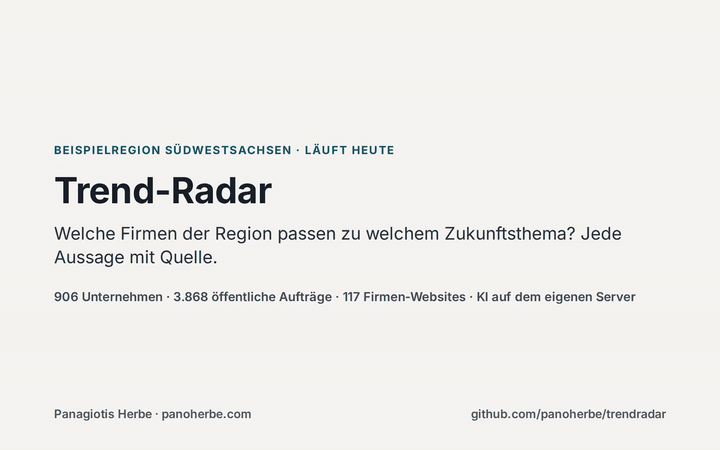
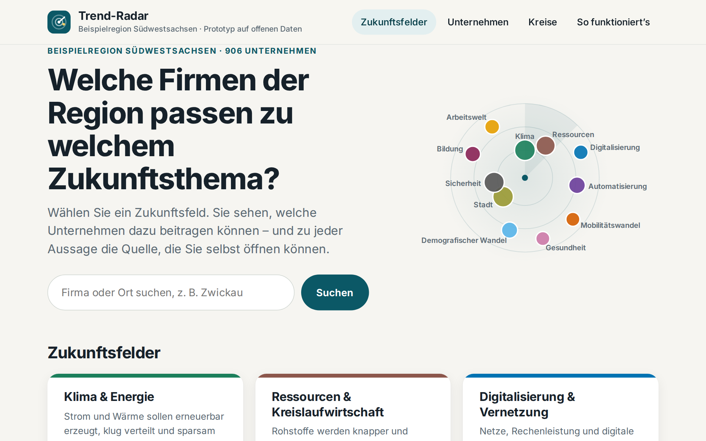
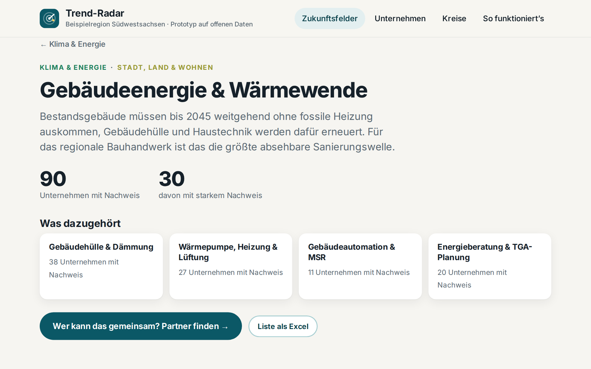
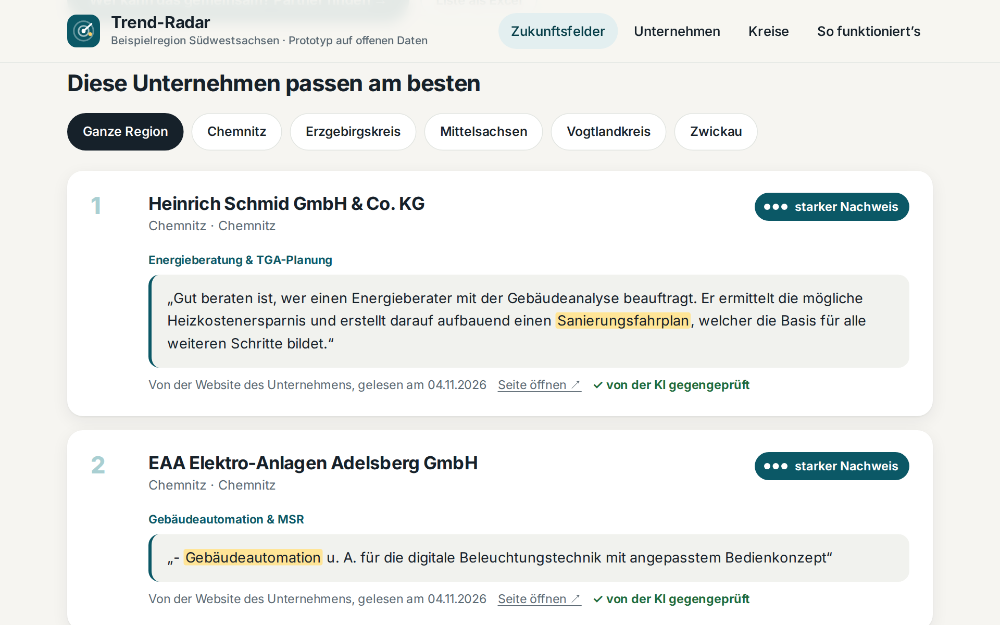
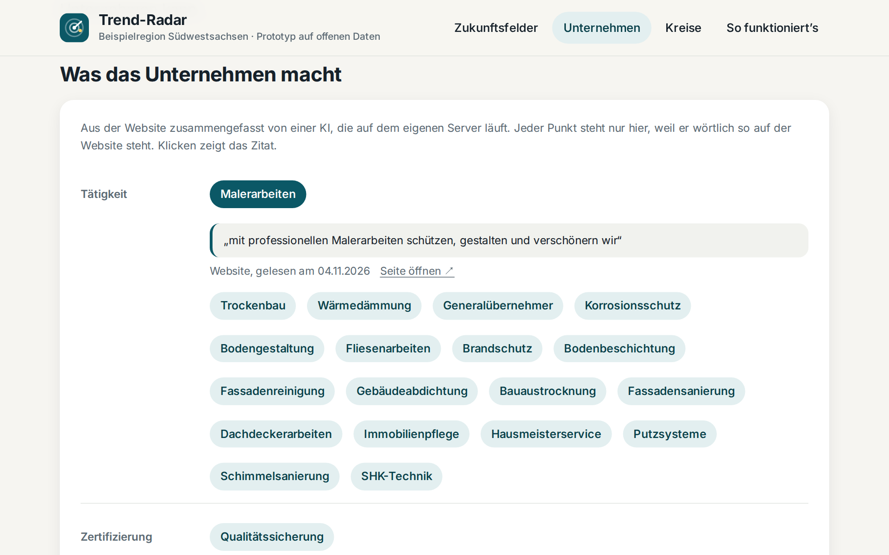
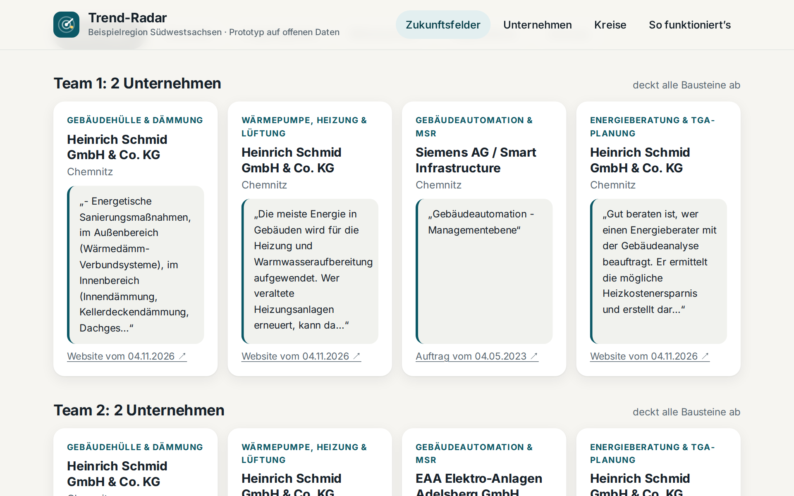
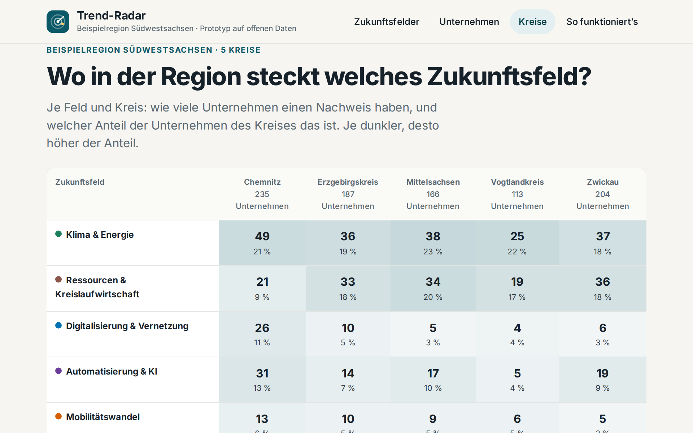
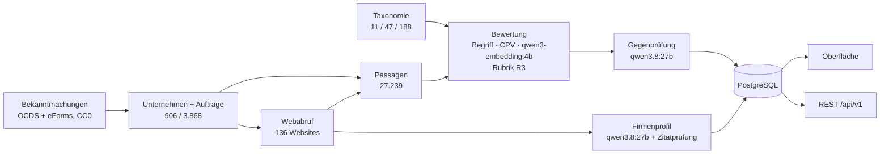

# Trend-Radar

**Welche Unternehmen einer Region passen zu welchem Zukunftsthema – und wer kann ein Thema gemeinsam anbieten? Der
Trend-Radar beantwortet beides, jede Aussage mit Quelle und wörtlichem Zitat. Er läuft heute auf offenen Daten einer
Beispielregion (Südwestsachsen, 906 Unternehmen), mit offenen KI-Modellen auf dem eigenen Server.**



<sub>Rundgang, 79 Sekunden, ohne Ton, mit Untertiteln; aufgenommen am 16.11.2026 an einer laufenden Installation
dieses Repositorys. [Video herunterladen (MP4, 4,5 MB)](https://github.com/panoherbe/trendradar/raw/main/medien/rundgang.mp4)
· Text des Rundgangs weiter unten.</sub>

## Für wen

Kurz: für alle, die wissen wollen, was die Firmen ihrer Region können, und dafür Belege brauchen.

- **Wirtschaftsförderungen und Kammern:** Welche Firmen passen zu einem Förderprogramm, einer Ansiedlung, einer
  Veranstaltung? Wer fehlt in der Region?
- **Kommunen, Klimaschutz- und Energiemanagement:** Wer in der Region baut Wärmepumpen ein, saniert Gebäude, plant
  Wärmenetze?
- **Regionalmanagements, Cluster, Transferstellen von Hochschulen:** Wer kann mit wem ein Thema gemeinsam anbieten?

## Was Sie damit fragen können → läuft hier schon

Kurz: Jede Zahl unten ist gemessen und steht mit Datum in [`nachweis/`](nachweis/).

| Frage | läuft hier schon (Stand 11.11.2026; Lasttest 16.11.2026) |
|---|---|
| Welche Firmen passen zu einem Zukunftsthema? | 906 Unternehmen × 47 Themen = 42.582 Einordnungen in 11 Zukunftsfeldern; 956 Paare mit Nachweis |
| Kann ich das nachprüfen? | Stufen 1–10, in Worten gezeigt („starker Nachweis“, „Nachweis“, „Hinweis“); jeder Nachweis zeigt seine Textstelle: öffentliche Bekanntmachung oder Website, mit wörtlichem Zitat und Link. Nachgeprüft: 3.746 von 3.746 gezeigten Zitaten stehen wörtlich in der gespeicherten Quelle |
| Was heißt ein Zukunftsthema konkret? | jedes Thema ist in 4 Bausteine zerlegt (188 insgesamt), jeder mit Fachbegriffen, CPV-Codes und Beschreibung; verglichen wird Unternehmen ↔ Baustein |
| Was macht eine Firma? | **Firmenprofil aus der Website:** die KI schlug 2.002 Merkmale vor, das Programm prüfte jedes Zitat: 1.970 übernommen, 6 doppelt, **26 verworfen** (1,3 %), weil das Zitat nicht wörtlich in der genannten Textstelle stand (21) oder zu kurz war (5) |
| Erfindet die KI etwas? | **Gegenprüfung:** die KI prüfte 5.047 Textstellen der 2.539 Paare ab Stufe 6: 1.738 bestätigt, 3.309 aussortiert (Nebenpositionen in langen Leistungsverzeichnissen, bloße Gebäudetypen, Floskeln); danach zählt nur Bestätigtes |
| Wie gut ist die Einordnung? | **Blinde Zweitbewertung** derselben 326 Paare durch ein großes Sprachmodell: 78 % innerhalb ±2 Stufen; wo der Radar einen Nachweis zeigt, **76 %**; wo die Zweitbewertung einen Nachweis sieht, 73 %, das heißt: einige Nachweise findet der Radar noch nicht ([Messprotokoll 11.11.2026](nachweis/2026-11-11/MESSPROTOKOLL.md)) |
| Welche Modelle? | die neueste Generation offener Modelle, per Messung gewählt: Einbettung `qwen3-embedding:4b` (bestes von fünf Kandidaten), Sprachmodell `qwen3.8:27b`; beide Apache 2.0, lokal über Ollama |
| Was, wenn eine Firma wenig über sich sagt? | „zu wenig Angaben“ ist ein eigener Status (74 Unternehmen), nie ein schlechter Wert; Durchschnitte stehen nie ohne Anzahl |
| Werden Websites fair gelesen? | 136 Websites: 117 gelesen (86 %), 1.182 Seiten mit 1.419 Abrufen in gut 5 Minuten; robots.txt nach RFC 9309 und Nutzungsvorbehalt nach § 44b UrhG beachtet, höchstens ein Abruf je Sekunde und Domain; jeder Ausfall mit Grund |
| Kann ich eigene Themen einspielen? | eine Datei ([`taxonomie/trends.yaml`](taxonomie/trends.yaml)); Version und Inhalts-Hash stehen an jeder Bewertung; eine widersprüchliche Taxonomie wird beim Laden abgewiesen |
| Wer kann das gemeinsam? | **Partner finden:** Teams aus der Region, die zusammen jeden Baustein eines Themas mit Nachweis abdecken; was niemand in der Region kann, steht als Lücke da |
| Wo in der Region steckt was? | Radar der elf Zukunftsfelder auf der Startseite; Tabelle Zukunftsfeld × Kreis; alle Themen als Liniennetz unter `/karte` |
| Hält das große Bestände aus? | **Lasttest mit simulierten Daten** (16.11.2026): 100.000 Unternehmen × 100 Themen = 10 Mio. Einordnungen, 10 gleichzeitige Nutzer, drei Läufe zu 60 s: 95 % der Antworten unter 1,2 s im ersten Lauf direkt nach dem Laden (dort 3 von 1.565 Anfragen mit Serverfehler), unter 0,62 s in zwei Wiederholungen ohne Fehler ([Messprotokoll 16.11.2026](nachweis/2026-11-16/MESSPROTOKOLL.md)) |
| Kann ich die Ergebnisse weiterverwenden? | Schnittstelle (REST, OpenAPI) unter `/api/v1`, Export als CSV und Excel |
| Wohin gehen die Texte? | Die Anwendung schickt keinen Text in eine Cloud; nur die einmalige Qualitätsmessung nutzte ein kommerzielles Sprachmodell (öffentliche Texte). Beide Modelle der Anwendung laufen auf dem eigenen Server. Ansprechpersonen, E-Mail, Telefon und Steuernummern werden nie gelesen; E-Mail-Adressen, Telefonnummern und Namen nach einer Anrede werden vor dem Speichern entfernt |
| Ist das geprüft? | 40 automatische Tests, darunter eine Prüfung aller ausgelieferten Datendateien auf E-Mail-Adressen und Telefonnummern |
| Darf ich das nutzen? | Quellcode unter AGPL-3.0, offen und frei; beide Modelle unter Apache 2.0 |

## In zwei Minuten selbst prüfen

Kurz: Messprotokoll lesen, mit einem Befehl starten, Tests laufen lassen.

1. **Das Messprotokoll lesen:** [nachweis/2026-11-11/MESSPROTOKOLL.md](nachweis/2026-11-11/MESSPROTOKOLL.md), mit dem,
   was noch nicht gut genug ist.
2. **Die Anwendung starten** (Docker mit Compose; ohne GPU, ohne Modell, der Datenstand liegt im Repository):
   ```bash
   git clone https://github.com/panoherbe/trendradar.git
   cd trendradar
   docker compose up -d
   ```
   Oberfläche: <http://127.0.0.1:8470> · Schnittstelle: <http://127.0.0.1:8470/api/v1/docs>
3. **Die Tests laufen lassen:** `docker compose run --rm test`

Gemessen: 24 s vom Bauen ohne Zwischenspeicher bis zur ersten Antwort, wenn die Basis-Images schon da sind
([`nachweis/2026-11-04/start.txt`](nachweis/2026-11-04/start.txt)); auf einem neuen Rechner kommt ihr einmaliger
Download dazu.

## Was man heute schon prüfen kann

Kurz: wie die Einordnung zustande kommt, und wie gut sie ist.

- **Jede Aussage hat eine Quelle:** ein Zitat und einen Link, jede Regel lesbar, jede Gegenprüfung gezählt.
- **Die Qualität ist gemessen, nicht behauptet**, auch dort, wo sie noch nicht reicht. Derselbe Messweg prüft jede
  Änderung an Themen, Schwellen und Modellen; der Modellwechsel vom 11.11.2026 ist so gemessen.
- **Die heiklen Teile sind von Anfang an da:** „zu wenig Angaben“ statt Scheinwerten, Zitatprüfung, höflicher und
  rechtlich sauberer Webabruf, Lasttest mit 100.000 simulierten Unternehmen.
- **Keine Bindung an einen Anbieter:** offener Quellcode, offene Modelle, Modelle austauschbar.

## So sieht es aus

<table>
<tr>
<td width="50%" valign="top"><br><sub>Der Einstieg: ein Zukunftsfeld wählen. Je größer der Punkt, desto mehr Firmen der Region haben einen Nachweis.</sub></td>
<td width="50%" valign="top"><br><sub>Ein Thema: was dazugehört und wie viele Firmen jeden Baustein können. Von hier zu den Partnern oder als Excel-Liste.</sub></td>
</tr>
<tr>
<td width="50%" valign="top"><br><sub>Die passenden Firmen, jede mit Zitat, markierter Fundstelle und Link zur Quelle; ein Klick filtert nach Kreis.</sub></td>
<td width="50%" valign="top"><br><sub>Was eine Firma macht, aus ihrer Website: jedes Merkmal steht nur da, weil es wörtlich so auf der Website steht.</sub></td>
</tr>
<tr>
<td width="50%" valign="top"><br><sub>Partner finden: Teams, die zusammen jeden Baustein abdecken, je Mitglied mit Zitat; Lücken der Region stehen als Hinweis da.</sub></td>
<td width="50%" valign="top"><br><sub>Wo in der Region steckt welches Zukunftsfeld: Anzahl und Anteil je Kreis.</sub></td>
</tr>
</table>

<details>
<summary><b>Text des Rundgangs</b> (die Untertitel des Videos)</summary>

| ab | Untertitel |
|---|---|
| 0:00 | **Karte:** Beispielregion Südwestsachsen · läuft heute — **Trend-Radar** — Welche Firmen der Region passen zu welchem Zukunftsthema? Jede Aussage mit Quelle. 906 Unternehmen · 3.868 öffentliche Aufträge · 117 Firmen-Websites · KI auf dem eigenen Server |
| 0:04 | Zuerst ein Zukunftsfeld wählen. (Je größer der Punkt, desto mehr Firmen der Region haben dafür einen Nachweis.) |
| 0:10 | Jedes Feld hat mehrere Themen – mit der Zahl der Firmen, die es nachweislich können. |
| 0:16 | Ein Thema: was dazugehört, und wie viele Firmen der Region jeden Baustein können. |
| 0:22 | Die passenden Firmen, jede mit einem Zitat und dem Link zur Quelle. („von der KI gegengeprüft“: Eine KI auf dem eigenen Server hat jeden Nachweis noch einmal geprüft.) |
| 0:29 | Ein Klick, und nur ein Kreis bleibt. |
| 0:33 | Was die Firma macht: aus ihrer Website, von der KI zusammengefasst. |
| 0:38 | Ein Klick zeigt das Zitat. Gezeigt wird nur, was wörtlich auf der Website steht. (Die KI schlug 2.002 Punkte vor; 26 fielen bei der Prüfung durch (Zitat nicht wörtlich oder zu kurz) und wurden verworfen.) |
| 0:45 | Und zu welchen Zukunftsthemen die Firma passt, jeweils mit Nachweis. |
| 0:49 | Wer kann das gemeinsam? Teams aus der Region, die zusammen jeden Baustein abdecken. |
| 0:55 | Wo niemand in der Region etwas kann, steht die Lücke da: hier „Betriebsführung & Wartung“. (Ein Ansatzpunkt für Ansiedlung, Partner von außerhalb oder eine gezielte Ansprache.) |
| 1:00 | Wo in der Region steckt welches Zukunftsfeld? |
| 1:03 | Jede Aussage hat eine Quelle. Alles läuft auf dem eigenen Server, kein Text geht in eine Cloud. |
| 1:08 | **Karte „Gemessen – Nachvollziehbar und schnell“:** 63 % → 76 % Übereinstimmung mit einer blinden Zweitbewertung, wo der Radar einen Nachweis sieht (neue KI-Modelle seit 11.11.) · 3.746 von 3.746 gezeigten Zitaten stehen wörtlich in der Quelle (nachgeprüft) · 3.309 Treffer hat die KI beim Gegenprüfen aussortiert, 1.738 bestätigt · 1.142 ms Antwortzeit für 95 % der Anfragen bei 100.000 Firmen und 10 gleichzeitigen Nutzern (Lasttest mit simulierten Daten) |
| 1:14 | **Karte „Selbst prüfen“:** Quellcode, Daten, Messprotokoll. Die Anwendung startet mit einem Befehl auf Ihrem Rechner. github.com/panoherbe/trendradar |

</details>

## Was der Prototyp noch nicht ist

Kurz: ein Prototyp auf offenen Daten einer Beispielregion, kein fertiges Produkt. Das fehlt noch:

| Heute noch nicht enthalten | Wie es weitergehen kann |
|---|---|
| Ein vollständiger Unternehmensbestand: die 906 Unternehmen haben öffentliche Aufträge gewonnen; Bau und Dienstleistung sind über-, Industrie ist unterrepräsentiert | ein vollständiger Bestand einer Region (z. B. aus offenen Registerdaten) mit Import, Prüfung, Fehlerbericht und Dublettenerkennung |
| Andere Regionen ohne Programmierung: Region und Kreise der Beispielregion stehen heute im Code (`trendradar/quellen/auftraege.py`, `trendradar/abfragen.py`) | Region als Einstellung, Daten neu rechnen |
| Abgestimmte Themen: die mitgelieferte Taxonomie ist eine eigene Beispiel-Taxonomie (11 Zukunftsfelder, 47 Themen) | Themen und Bausteine mit Fachleuten einer Region abstimmen; eine Taxonomie ist eine einzige Datei ([`taxonomie/trends.yaml`](taxonomie/trends.yaml)) |
| Ein Urteil von Fachleuten: die Zweitbewertung stammt von einem großen Sprachmodell; einige Nachweise, die sie sieht, findet der Radar nicht ([Messprotokoll 11.11.2026](nachweis/2026-11-11/MESSPROTOKOLL.md), Abschnitt 4) | eine Referenzstichprobe, von Fachleuten bewertet, und die Schwellen daran ausrichten |
| Kalibrierte Schwellen: die Schwellen für semantische Nähe sind am Vorgängermodell von Hand an Grenzfällen festgelegt und für das neue Modell über die Verteilung übertragen | Kalibrierung an der Referenzstichprobe, je Modell und Taxonomie-Version |
| Hardware für das große Modell: auf der GPU dieser Demo (12 GB) liegt `qwen3.8:27b` nur etwa zur Hälfte im Grafikspeicher, die Gegenprüfung braucht rund 13 s je Paar | eine GPU mit genug Speicher; das Modell ist austauschbar |
| Seiten, die nur mit JavaScript lesbar sind, und PDF-Dokumente der Websites (5 Websites ohne lesbaren Text) | Browser-Kette (Playwright) und PDF-Text, im Vergleich gemessen |
| Amtliche Statistik je Kreis (Beschäftigte nach Branche) | anbinden, sobald eine offene Datei ohne Anmeldung vorliegt |
| Anmeldung, Konten und Rollen | persönliche Konten und Rollen, Anmeldung für Oberfläche und Schnittstelle |
| Betrieb mit Überwachung, Sicherung und Wiederherstellung | einrichten und beschreiben |

Aus Auftrags- und Website-Texten werden E-Mail-Adressen, Telefonnummern und Namen nach einer Anrede („Frau …“, „Herrn …“)
entfernt; Namen ohne Anrede erkennt das nicht. Impressum, Kontakt und Karriere-Seiten werden gar nicht erst gelesen.

## Kontakt

Panagiotis Herbe · [panoherbe.com](https://panoherbe.com)

---

## Technik im Detail

### Bausteine

| Baustein | Umsetzung |
|---|---|
| Unternehmen und Aufträge | tägliche OCDS- und eForms-Exporte des Bekanntmachungsservice öffentlicher Auftraggeber; Auftragnehmer mit Sitz in der NUTS-Region DED4 (Stadt Chemnitz, Erzgebirgskreis, Mittelsachsen, Vogtlandkreis, Zwickau); Zuordnung Auftragnehmer → Los aus eForms (`LotResult` → `LotTender` → `TenderingParty`), weil der OCDS-Export sie nicht enthält; mehrere Auftragnehmer ohne eForms-Zuordnung → kein Beleg statt eines falschen ([`quellen/auftraege.py`](trendradar/quellen/auftraege.py)) |
| Webabruf | robots.txt (Protego, RFC 9309), `tdm-reservation` (Kopf und Meta), 1 Abruf/s je Domain, 2 Versuche, höchstens 15 Seiten, keine Impressum-, Kontakt-, Karriere- und Kundenseiten, Weiterleitung auf fremde Domain = verworfen; Text mit trafilatura, nummerierte Passagen, Kontaktdaten entfernt ([`quellen/web.py`](trendradar/quellen/web.py)) |
| Fähigkeits-Brücke und Bewertung | Signale je Passage und Baustein: Fachbegriff, CPV-Präfix, Kosinus der Vektoren von `qwen3-embedding:4b` (lokal über Ollama, [`einbettung.py`](trendradar/einbettung.py)); feste Rubrik, Regelversion R3; ein CPV-Code allein trägt höchstens Stufe 7; Schwellen je Modell über denselben Anteil aller Paare Passage × Baustein wie beim Vorgänger ([`daten/schwellen.json`](daten/schwellen.json), [`bewertung.py`](trendradar/bewertung.py)) |
| Gegenprüfung | `qwen3.8:27b` (lokal über Ollama) prüft jede Belegstelle der Paare ab Stufe 6; danach zählt die Rubrik nur bestätigte Belege; Urteile je Modell zwischengespeichert, ein erneuter Lauf ist reproduzierbar ([`pruefschritt.py`](trendradar/pruefschritt.py)) |
| Firmenprofil | `qwen3.8:27b` füllt ein festes Schema (Tätigkeit, Produkt, Verfahren, Werkstoff, Zielbranche, Zertifizierung, Technologie) mit Passage und Zitat; der Code verwirft jedes Merkmal ohne wörtliches Zitat ([`merkmale.py`](trendradar/merkmale.py)) |
| Wert je Zukunftsfeld | zwei gespeicherte Regeln zur Auswahl: höchster Themenwert und Mittel der drei höchsten |
| Partner finden | gierige Mengenüberdeckung über eindeutige Belege je Baustein, Gleichstand: gleicher Kreis, mehr Belege; deterministisch ([`kooperation.py`](trendradar/kooperation.py)) |
| Radar und Liniennetz | Radar der Zukunftsfelder auf der Startseite (SVG, Punktgröße nach Unternehmen mit Nachweis); Liniennetz unter `/karte`: Zeilenfolge und Spalten aus der Taxonomie berechnet (keine zwei Stationen einer Linie in einer Spalte, keine Verbindung durch eine fremde Station), SVG ([`karte.py`](trendradar/karte.py)) |
| Datenhaltung | PostgreSQL 16; Werte als schmale Tabelle (Unternehmen × Thema) mit Index je Thema und Wert; Kennzahlen je Thema und Kreis beim Laden berechnet ([`schema.sql`](trendradar/schema.sql)) |
| Oberfläche und Schnittstelle | FastAPI, Jinja-Vorlagen, eine Handlung je Bildschirm, Schrift Inter (SIL OFL 1.1, mitgeliefert); OpenAPI 3.1 unter `/api/v1/openapi.json`; Seiten zu 50 oder 200 Einträgen, Fehler als JSON mit Korrelations-ID, 60 Anfragen je Minute (HTTP 429 mit Retry-After), Protokoll ohne Inhaltsdaten ([`app.py`](trendradar/app.py)) |
| Modellwahl | Messung der Kandidaten gegen die blinde Zweitbewertung, Quantil-Abgleich der Schwellen, Vergleich vorher/nachher ([`modellwahl.py`](trendradar/modellwahl.py)) |

### Datenfluss



### Start

Voraussetzung: Docker mit Compose. Der Datenstand liegt in `daten/`; die Anwendung braucht kein Modell und keine GPU.

```bash
docker compose up -d                 # Datenbank, Laden des Datenstands, Anwendung auf 127.0.0.1:8470
docker compose run --rm test         # automatische Tests
docker compose down -v               # alles wieder entfernen
```

### Neu rechnen

Die Verarbeitung läuft in einem eigenen Image (`Dockerfile.pipeline`, ohne PyTorch); Einbettungs- und Sprachmodell laufen
in Ollama (`ollama/ollama:0.40.16`). Gemessen auf einem Linux-Rechner mit 16 Threads, 62 GB RAM und einer NVIDIA RTX 3060
(12 GB); `qwen3.8:27b` passt nicht ganz in 12 GB, Ollama lagert einen Teil der Schichten auf die CPU aus. Gemessen auf
dieser Karte: Einbettung 34 Textstellen je Sekunde, Gegenprüfung rund 13 s je Paar (2 parallele Anfragen), Firmenprofil
rund 2 min je Website ([`modellwahl_sprachmodell.json`](nachweis/2026-11-11/modellwahl_sprachmodell.json)).

```bash
docker network create ki
docker run -d --name ollama --network ki --gpus all -e OLLAMA_FLASH_ATTENTION=1 -e OLLAMA_KV_CACHE_TYPE=q8_0 \
  -v ollama:/root/.ollama ollama/ollama:0.40.16
docker exec ollama ollama pull qwen3-embedding:4b && docker exec ollama ollama pull qwen3.8:27b
docker build -f Dockerfile.pipeline -t trendradar-pipeline .
R="docker run --rm --network ki -e OLLAMA_URL=http://ollama:11434 -e SPRACHMODELL=qwen3.8:27b -v $PWD:/repo -w /repo trendradar-pipeline"
$R trendradar.quellen.auftraege --archiv <Ordner mit JJJJ-MM-TT/ocds.zip und eforms.zip> --aus daten
$R trendradar.quellen.cpv --belege daten/belege_auftraege.jsonl --aus daten/cpv_de.csv
$R trendradar.quellen.web --unternehmen daten/unternehmen.csv --roh roh/web --aus daten/web_lauf.jsonl
$R trendradar.bewertung --modell qwen3-embedding:4b --daten daten --web daten/web_lauf.jsonl
$R trendradar.pruefschritt --daten daten --messung nachweis/<datum>/pruefung.json
$R trendradar.merkmale --web daten/web_lauf.jsonl --aus daten/merkmale.jsonl --messung nachweis/<datum>/merkmale.json
$R trendradar.zitatpruefung --daten daten --roh roh/web --aus nachweis/<datum>/zitate.json
docker compose up -d --build         # neuen Datenstand in die Datenbank
```

**Ein anderes Modell messen:** `trendradar.modellwahl einbettung --modelle a,b` und `trendradar.modellwahl sprachmodell
--modelle a,b` messen Kandidaten gegen dieselbe blinde Zweitbewertung; `trendradar.modellwahl schwellen --nach <modell>
--aus daten/schwellen.json` gleicht die Schwellen eines neuen Einbettungsmodells ab; `trendradar.modellwahl vergleich`
vergleicht zwei Datenstände (Messprotokoll vom 11.11.2026).

**Lasttest:** `trendradar.last` erzeugt einen simulierten Bestand in einem eigenen Schema und misst die Antwortzeiten;
Befehle im [Messprotokoll 16.11.2026](nachweis/2026-11-16/MESSPROTOKOLL.md), Abschnitt 3.

Die Tagesexporte gibt es unter `https://oeffentlichevergabe.de/api/notice-exports?pubDay=JJJJ-MM-TT&format=ocds.zip`
(ebenso `format=eforms.zip`). Volltexte der Websites und Vektoren bleiben in `roh/` und gehören nicht ins Repository.

### Aufbau

```
trendradar/quellen/   Auftragsdaten (OCDS + eForms), Webabruf, CPV-Bezeichnungen
trendradar/           Taxonomie, Einbettung, Bewertung, Gegenprüfung, Firmenprofil, Partner, Liniennetz, Datenbank, App
taxonomie/            trends.yaml (Beispiel-Taxonomie), karte.json (berechnete Anordnung)
daten/                Datenstand: Unternehmen, Aufträge, Bewertungen, Belegstellen, Firmenprofile, CPV-Bezeichnungen
nachweis/<datum>/     Messprotokolle (2026-11-04: erster Stand; 2026-11-11: neue Modelle; 2026-11-16: Lasttest) und Rohergebnisse
tests/                automatische Tests (ohne Modell)
medien/               Rundgang und Bilder für diese Seite
```

### Daten und Lizenzen

- **Bekanntmachungen:** Bekanntmachungsservice öffentlicher Auftraggeber (oeffentlichevergabe.de), Lizenz CC0 1.0 (so in
  jedem OCDS-Paket: `"license": "https://opendefinition.org/licenses/cc-zero/"`); Stand der Exporte 01.12.2022 bis
  02.11.2026, Auftragsdaten der Bekanntmachungen 2012 bis 2026 (87 % ab November 2023).
- **CPV-Bezeichnungen:** Gemeinsames Vokabular für öffentliche Aufträge, Anhang der Verordnung (EG) Nr. 213/2008;
  abgerufen über den SPARQL-Endpunkt des Amts für Veröffentlichungen der EU (EU Vocabularies), Weiterverwendung nach
  Beschluss 2011/833/EU mit Quellenangabe.
- **Websites:** öffentliche Seiten der Unternehmen, abgerufen am 04.11.2026; gezeigt werden kurze Zitate mit Quelle.
  Die Volltexte liegen nicht im Repository.
- **Taxonomie:** eigene Formulierung, Lizenz wie der Quellcode.
- **Modelle:** `qwen3-embedding:4b` (Apache 2.0), `qwen3.8:27b` (Apache 2.0); im Datenstand vom 04.11.2026 `BAAI/bge-m3`
  (MIT) und `qwen2.5:7b-instruct` (Apache 2.0). Die Zweitbewertung (`nachweis/2026-11-04/`) stammt von einem großen
  kommerziellen Sprachmodell; es ist nicht Teil der Anwendung.
- **Schrift:** Inter (SIL Open Font License 1.1, [`trendradar/static/schrift/OFL.txt`](trendradar/static/schrift/OFL.txt)).

### Rundgang und Bilder

Aufgenommen am 16.11.2026 mit Playwright (Chromium) an einer laufenden Installation dieses Repositorys (`docker compose
up`) auf einem Linux-Server, Datenstand wie im Messprotokoll vom 11.11.2026. Thema und Unternehmen wählt das
Aufnahmeskript aus der Schnittstelle (ein Thema, dessen erstes Partner-Team jeden Baustein abdeckt; ein Unternehmen mit
Firmenprofil unter den ersten zehn seines Kreises), die Lücken-Szene ein Thema mit Lücke. Der Rundgang ist eine
Bildfolge mit Haltezeiten: die Abstände zwischen den Schritten sind nicht die echte Bediendauer. Untertitel und
Mauszeiger sind in die Seite gezeichnet, ohne Ton. Die Zahlen der Karten liest das Skript aus `/api/v1/stand`, also aus
den Dateien in `nachweis/`; der Lasttest ist als simuliert gekennzeichnet und mit seinem langsamsten Lauf genannt.

## Lizenz

Quellcode, Vorlagen, Taxonomie und die eigenen Ergebnisse (Bewertungen, Messungen): AGPL-3.0 (`AGPL-3.0-only`,
[`LICENSE`](LICENSE)). Darin enthalten sind Auszüge aus den Bekanntmachungen (CC0 1.0), CPV-Bezeichnungen (Beschluss
2011/833/EU) und kurze Zitate aus öffentlichen Websites mit Quelle; für sie gelten die Angaben unter „Daten und
Lizenzen“. Schrift Inter: SIL OFL 1.1.
